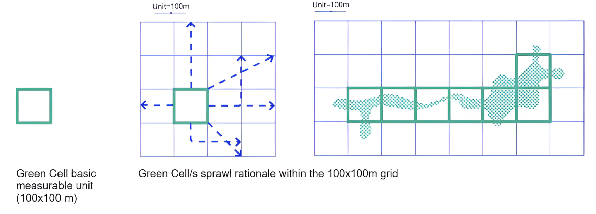

<div align="center">
  
</div>

<div align="center">
  <a href="https://www.linkedin.com/in/christiandibuo/" target="_blank">Christian Di Buò</a> &nbsp; | &nbsp;
  <a href="https://www.linkedin.com/in/simreale" target="_blank">Simone Reale</a>
</div>

# Sustainable City via Trustworthy Digital Twin: a Use Case

Bologna, like many European cities, faces growing challenges from climate change, biodiversity loss, pollution, and unequal access to public space. 
Problems like Urban Heat Islands (UHI) and Urban Heat Waves (UHW) particularly threaten vulnerable communities, straining public health and reducing quality of life. 

To address these issues, the __*TALEA*__ project, supported by the *European Urban Initiative – Innovative Actions (EUI-IA)*, introduces **TALEA Green Cells (TGCs)**: modular, adaptable green units that reconnect fragmented green areas, regenerate underutilized spaces, and create local climate refuges.

<div align="center">
  
</div>

This repository presents a **transparent methodology for planning TGCs placement in Bologna**, relying on **interpretable AI optimization techniques**. The workflow combines open-source urban and demographic data with optimization-based modeling to explore how the distribution of Green Cells shifts under factors such as *population density*, *urban indices* or *land use*.

## Data

### Land Usage Dataset

<br>

<div style="display:flex;align-items:center;gap:25px;">
    
    <div>
        <a href="https://geoportale.regione.emilia-romagna.it/approfondimenti/database-uso-del-suolo" target="_blank"><h4>Urban fabric</h4></a>
        <ul>
            <li>Mapping of the various uses of the territory, classified according to a hierarchical legend derived from the specifications of the European project Corine Land Cover (CLC), integrated by the Land Use Working Group of CPSG-CISIS.</li>
        </ul>
    </div>
</div>

<br>

### Green Cover Dataset

<br>

<div style="display:flex;align-items:center;gap:25px;">
    
    <div>
        <a href="https://opendata.comune.bologna.it/explore/dataset/un_gest/information/?flg=it-it&disjunctive.classe_unita_gestionale&disjunctive.area_statistica&disjunctive.zona_prossimita&disjunctive.quartiere" target="_blank"><h4>Municipal Green</h4></a>
        <ul>
            <li>Green units under the maintenance of the Bologna Municipality, including a wide range of categories, like flowerbeds, gardens, parks, ponds, school and sports green areas, roadside decorative greenery, etc.</li>
        </ul>
        <a href="https://opendata.comune.bologna.it/explore/dataset/verde_privato_urbanizzato/information/?flg=it-it" target="_blank"><h4>Private Green</h4></a>
        <ul>
            <li>Mapping of the private green areas within the Bologna cityscape.</li>
        </ul>
        <a href="https://opendata.comune.bologna.it/explore/dataset/alberi-manutenzioni/information/?flg=it-it&disjunctive.cl_h&disjunctive.dimora&disjunctive.classe&disjunctive.zona_di_prossimita&disjunctive.area_statistica" target="_blank"><h4>Municipal Trees</h4></a>
        <ul>
            <li>Mapping of the trees planted in the Bologna cityscape, containing the coordinates of each element and the information about the type of tree.</li>
        </ul>
    </div>
</div>

<br>

<div style="display:flex;align-items:center;gap:25px;">
    
    <div>
        <a href="https://geoportale.regione.emilia-romagna.it/catalogo/dati-cartografici/ambiente/carte-forestali/provincia-di-bologna" target="_blank"><h4>Forestal scape</h4></a>
        <ul>
            <li>Landscape area covered by tree and/or shrub and/or bush vegetation of forest species, whether of natural or artificial origin, at any stage of development, with a density greater than 10%.</li>
        </ul>
        <a href="https://geoportale.regione.emilia-romagna.it/catalogo/dati-cartografici/acque-interne" target="_blank"><h4>Riverscape</h4></a>
        <ul>
            <li>Landscape area covered by water, including rivers, riverbeds and lakes.</li>
        </ul>
    </div>
</div>

<br>

### Human Infrastructure

<br>

<div style="display:flex;align-items:center;gap:25px;">
    
    <div>
        <a href="https://opendata.comune.bologna.it/explore/dataset/rifter_edif_pl/information/?flg=it-it" target="_blank"><h4>CTC - Particle Buildings</h4></a>
        <ul>
            <li> Mapping of buildings with parcel details extracted from the Municipal Technical Map and public cadastral information (Sheet/Parcel).</li>
        </ul>
        <a href="https://opendata.comune.bologna.it/explore/dataset/aree-stradali/information/?flg=it-it&disjunctive.descrizion&disjunctive.origine" target="_blank"><h4> CTC - Road Area</h4></a>
        <ul>
            <li>Street areas in the city of Bologna, including all the different types of roads, parking areas and squares, extracted from the Municipal Technical Map.</li>
        </ul>
    </div>
</div>

<br>

### Statistical Data

<br>

<div style="display:flex;align-items:center;gap:25px;">
    
    <div>
        <a href="https://opendata.comune.bologna.it/explore/dataset/aree-statistiche/information/?flg=it-it" target="_blank"><h4>Statistical Areas</h4></a>
        <ul>
            <li>Division of the municipal territory into 90 statistical areas, more detailed way than the traditional division of Bologna into districts or zones.</li>
        </ul>
        <a href="https://inumeridibolognametropolitana.it/dati-statistici/popolazione-residente-quartiere-zona-e-area-statistica-al-31-dicembre" target="_blank"><h4>Population per statistical area</h4></a>
        <ul>
            <li>Dataset of the population density of Bologna, computed at different levels of granularity (districts, city zones and statistical areas).</li>
        </ul>
    </div>
</div>

<br>

<div style="display:flex;align-items:center;gap:35px;">
    
    <div>
        <a href="https://github.com/TALEA-platform/uhi" target="_blank"><h4>Urban Heat Island Analysis</h4></a>
        <ul>
            <li>Analysis of the Urban Heat Island (UHI) effects in the city of Bologna, by processing and integrating satellite data from Landsat 8/9 and MODIS with spatial indicators like NDVI, LST, Albedo, and derived composite indices.</li>
        </ul>
    </div>
</div>

<br>

## Models

The placement of TGCs is modeled as a **Combinatorial Optimization Problem (COP)** and relies on the impact of different factors on *micro* and *macro scale* and on how fragmented each area is.

The *macro scale* is referred to the statistical areas, where three indices are considered:
- *population density*
- *existing green*
- *UHEI*

The *micro scale* is referred to the grid of 100x100 m cells, and is modeled differently according to four different approaches:

| Standard | Difference | Inverse UHEI | NDVI |
|:--------------:|:--------------:|:--------------:|:--------------:|
|It aims to maximize a utility function, which is directly proportional to new green areas and inversely to existing ones. |Based on the same concept of the Standard one, it considers the impact of the existing green in a differential way. |It maximizes the impact of the FVC on the Inverse UHEI, directly w.r.t. new TGCs and inversely to the existing vegetation. |It maximizes the impact of the FVC on the NDVI, according to a quadratic relation, inversely proportional to the actual NDVI of the cell. |

> [!NOTE]
> Further details on models, indices and sources of this study can be found in the **report** and in the **documentation**.


## 3-30-300 extension (branch `3-30-300`)

This branch extends the original TALEA Green Cells optimization with the **3-30-300 urban greenness rule**. The original TALEA models and documentation above remain the baseline; the two additional models and the associated preprocessing, evaluation and sensitivity experiments are specific to this extension.

The three criteria are evaluated using the following operational definitions:

- **3 trees:** a residential building satisfies the criterion if at least three mapped trees lie within 50 m of its centroid **or** if it is within 300 m of an existing park/garden (the additional convention used by this project). New trees are estimated from the allocated green surface using configurable trees-per-square-metre coefficients.
- **30% canopy:** a statistical area satisfies the criterion when estimated tree-canopy coverage reaches 30%. Initial coverage comes from the canopy raster; additional canopy is estimated from allocated green surface and distributed to statistical areas according to the fraction of each grid cell that overlaps them.
- **300 m to green space:** a residential building satisfies the criterion if it lies within 300 m of an existing park/garden. In the intervention scenarios, a selected Green Cell is treated as a potential new accessible green space, so buildings within 300 m of that cell are counted as newly covered.

Distances are **Euclidean** in a metric projected CRS, not walking-network distances. Buildings are assigned to statistical areas by their centroid; existing trees and parks can contribute across statistical-area boundaries.

### Optimization approaches

The extension compares the existing **Standard (STD)** baseline with two additional MiniZinc models:

| Model | Optimization objective |
| --- | --- |
| [Counterfactual](src/Minizinc/models/std_330300_model.mzn) (`std_330300`) | Adds a locally estimated 3-30-300 benefit to each cell's original TALEA utility, weighted by `gamma_330300`. Its cell-level benefits are not identical to the global post-intervention KPI. |
| [MaxCoverage](src/Minizinc/models/std_330300_maxcoverage_model.mzn) (`std_330300_maxcoverage`) | Maximizes original STD utility plus `gamma_330300` times the mean fraction of the **initial deficits recovered** for the three criteria, evaluated at building/statistical-area level. |

The models share the original placement constraints, including a maximum number of selected cells, available intervention surfaces, and a minimum allocated surface per selected cell (`delta`).

**Important modeling assumptions and limitations:**

- A Green Cell counts toward **criterion 300** as soon as it is selected and receives the minimum feasible allocation (`delta = 1 m²` in the default experiments). The model **does not** impose a minimum park size, verify public access, or guarantee that this intervention becomes a formally designated park. This is a simplified *potential accessibility* indicator, **not** a claim that every 1 m² intervention is a functioning public park.
- For **criterion 3**, new trees are estimated as `floor(tree_density_street × street_area + tree_density_yard × yard_area)`. The proximity test uses the geometry of the selected cell relative to a building's centroid; the model does not optimize the precise position of individual newly planted trees inside the cell.
- For **criterion 30**, estimated canopy is proportional to the newly allocated surface. It is not a simulation of tree growth or future canopy development.
- The objectives are deliberately different: improving the Counterfactual utility does not necessarily maximize the city-wide KPI. Results should therefore be compared with the same independent post-hoc evaluation.

### Reproducing and inspecting the extension

Configuration is maintained in versioned YAML scenario files under [`config/full/`](config/full/). From the repository root **inside the Docker environment**, after preparing the input data, run one model/scenario at a time:

```bash
run_model --config config/full/default.yaml --model std_330300
run_model --config config/full/default.yaml --model std_330300_maxcoverage
```

The default full-city experiments allow up to **100 selected cells**, use `gamma_330300 = 1`, `delta = 1 m²`, tree density `0.01 trees/m²` (street and yard), and canopy density `0.2 m²/m²` (street and yard). Other YAML scenarios vary `gamma_330300` or the assumed planting densities.

The extension's main files are:

- [`src/330300/prepare_data.py`](src/330300/prepare_data.py) and [`src/330300/compute_index.py`](src/330300/compute_index.py): prepare the geospatial layers, evaluate initial conditions, and create cell-to-building/statistical-area relationships.
- [`dataset/processed_data/330300/`](dataset/processed_data/330300/): versioned prepared layers and coverage relations used to reproduce the optimization inputs. Re-running `compute_index.py` downloads **current** OpenStreetMap building data and may therefore change the input dataset; use the committed processed files to reproduce the published experiments.
- [`src/data_parser.py`](src/data_parser.py): builds the MiniZinc instances from the processed layers and scenario parameters.
- [`results/full/std_330300/`](results/full/std_330300/) and [`results/full/std_330300_maxcoverage/`](results/full/std_330300_maxcoverage/): optimization outputs.
- [`analysis/evaluate_kpis.py`](analysis/evaluate_kpis.py), [`analysis/plot_kpis.py`](analysis/plot_kpis.py), [`analysis/results/`](analysis/results/) and [`analysis/plots/`](analysis/plots/): common post-hoc KPI evaluation, sensitivity-analysis tables and visualizations.

The **baseline** is evaluated using the same post-hoc assumptions as both extension models. The experimental KPI represents recovery of the defined initial 3-30-300 deficits, not a direct measure of realized public-space access or actual future planted canopy.

## Usage

To reproduce our results, ensure Docker is installed on your system. Once Docker is installed, to run the docker the following scripts should be executed from the terminal while in the Dockerfile directory:

- To build and run the docker

    ```
    docker-compose up --build -d
    ```

- To exec docker commands from your terminal

    ```
    docker exec -it TALEA bash
    ```

### Rules

There are two modalities to run the pipeline in the docker shell:

- one for running the entire pipeline, including the grid creation step, necessary for the first run, after changing the size and for changing something in the geometry of data

    ```bash
    run_pipeline
    ```

- one for running only the further processing steps, including the instance creation and the solver, used for changing parameter configuration

    ```bash
    run_model
    ```

> [!TIP]
> Run the `--help` option on each command for further details on usage and parameters configuration.

## Useful Links

This project relies on spatial data, which is best understood when visualized and exploring them in tables often leads to ambiguity and poor clarity. Therefore, a simple **Graphical User Interface (GUI)** has been implented to display GeoJson files.

<div align="center">
  <a href="https://talea-gui.netlify.app/">
    
  </a>
</div>
<br>

Furthermore, any step of the process is explained in a **report** and a **documentation** that follows the ReadTheDocs format, including further details on data, models and the results obtained.

<div align="center">
  <a href="TALEA_report.pdf">
    
  </a>
    &nbsp;
  <a href="https://talea-documentation.netlify.app/">
    
  </a>
</div>
<br>

## Citation

If you use this work or code for any purpose, please cite the following paper:
```
@INPROCEEDINGS{Borg2603:Sustainable,
AUTHOR="Christian {Di Buò} and Simone Reale and Roberta Calegari and Andrea
Borghesi",
TITLE="Sustainable City via Trustworthy Civic Digital Twin: a Use Case",
BOOKTITLE="DIGITA 2026 - Second Workshop on Digital Twin Ecosystems \& Applications
(DIGITA 2026)",
ADDRESS="Pisa, Italy",
PAGES=6,
DAYS=15,
MONTH=mar,
YEAR=2026,
KEYWORDS="Civic Digital Twins; Sustainability; Heat Exposure; Green Cells Placement",
ABSTRACT="Cities increasingly face urban heat and uneven access to green space. We
present a Digital Twin and an interpretable optimization framework that
recommends where to deploy modular green cells in Bologna, Italy. We fuse
municipal open data-land use, public/private green and blue areas,
buildings and roads-with satellite-derived heat and greenness indices
(UHEI, NDVI) and demographics into a grid structure. We then cast site
selection as a constraint optimization problem whose utility factorizes
into a macro component (policy levers over density,
heat exposure, and existing green) and a micro component (site-level
feasibility and expected impact). Scenario analyses show how shifting
policy priorities redistribute optimal placements across districts. The
suggestions from the model overlap with pilot areas identified by urban
experts, supporting practical relevance. The entire stack is containerized
for reproducibility and includes a lightweight GUI for spatial inspection.
We release all artifacts to foster the sustainability-driven Digital Twin
methods that are transparent, adaptable, and action-oriented."
}
```
