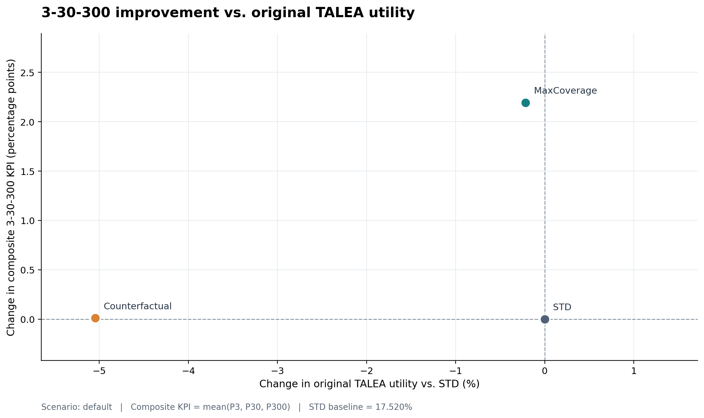
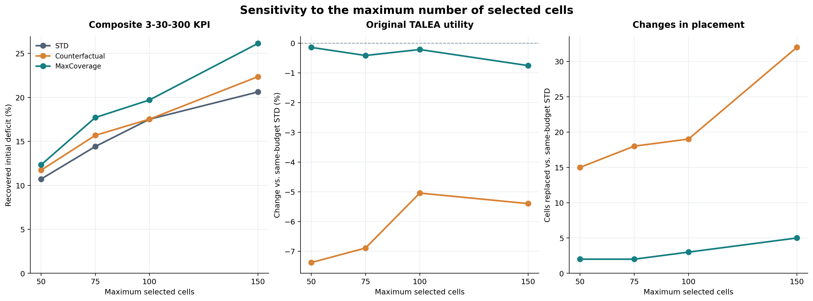
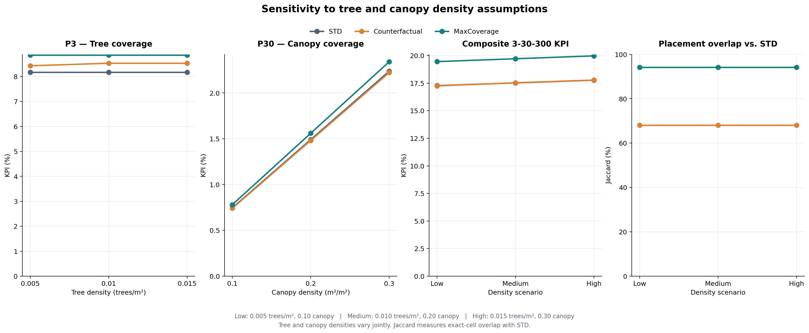

# 3-30-300 extension: experiments and results

[Methodology and assumptions](README.md) · [Project README](../../README.md)

The original TALEA Standard (**STD**), **Counterfactual** and **MaxCoverage** placements are evaluated on the same full-city grid using identical post-hoc assumptions. The optimization objectives themselves are not directly comparable.

## Experimental design

The reference scenario is [`config/full/default.yaml`](../../config/full/default.yaml): `max_cells = 100`, `gamma_330300 = 1`, `delta = 1 m²`, street/yard tree density **0.01 trees/m²**, street/yard canopy density **0.20 m²/m²**, street weight `beta_streets = 0.2`, yard weight `alpha_yards = 0.8`. Original macro weights remain **0.33** population density, **0.33** green deficit and **0.34** UHEI.

Three sensitivity analyses use the YAML profiles in [`config/full/`](../../config/full/):

| Sensitivity | Values | Comparison |
| --- | --- | --- |
| **3-30-300 weight** | `gamma_0`, `gamma_low`, `gamma_medium`, `gamma_high`: **0, 0.5, 1, 2** | Both extension models vs. the unchanged 100-cell STD baseline. |
| **Tree and canopy density** | `tree_density_low`, `_medium`, `_high`: **0.005/0.10**, **0.010/0.20**, **0.015/0.30** (trees/m² / canopy m²/m²) | Street and yard densities vary **together**; their separate effects are not isolated. |
| **Maximum selected cells** | **50, 75, 100, 150** | `max_cells_50`, `max_cells_75`, `default`, `max_cells_150`; **all three models are reoptimized at the same budget**, including STD. |

Other settings remain fixed within each sweep. The originally tested 25-cell run is not part of the reported budget sensitivity.

## Comparable KPIs

[`analysis/evaluate_kpis.py`](../../analysis/evaluate_kpis.py) applies the same physical assumptions to the selected placements and reports:

| Metric | Meaning |
| --- | --- |
| `P3_percent` | Share of initially missing trees supplied, capped at each building's deficit. |
| `P30_percent` | Share of initially missing canopy area recovered, capped at each statistical area's deficit. |
| `P300_percent` | Share of initially uncovered buildings newly reached within 300 m. |
| `KPI_330300_percent` | Arithmetic mean of **P3, P30 and P300**. |
| `TALEA_original_utility` | Original TALEA utility, reconstructed consistently for all placements at the **same cell budget**. |
| `TALEA_utility_change_percent` | Percentage change in original utility relative to the matching STD placement. |

Additional outputs include buildings/areas reaching compliance (`C3_percent`, `C30_percent`) and **Jaccard** similarity between selected cell IDs or buffered cell geometries. Recovered-deficit percentages are **not** the same as fully compliant-building/area percentages. None of these indicators measures realized planting, canopy growth or actual park access.

## Results: maximum-cell sensitivity

All figures below are percentages; changes in utility are relative to STD **at the same budget**.

| Max. cells | STD KPI | Counterfactual KPI | MaxCoverage KPI | Counterfactual Δ utility | MaxCoverage Δ utility |
| ---: | ---: | ---: | ---: | ---: | ---: |
| **50** | 10.71 | 11.72 | **12.34** | −7.38 | **−0.14** |
| **75** | 14.42 | 15.69 | **17.71** | −6.89 | **−0.42** |
| **100** | 17.52 | 17.53 | **19.71** | −5.05 | **−0.22** |
| **150** | 20.62 | 22.36 | **26.14** | −5.40 | **−0.76** |

**MaxCoverage leads on the composite KPI at every budget**, while reducing original TALEA utility by less than 1% in these runs. At **150 cells**, its KPI exceeds STD by **5.52 percentage points** (26.14% vs. 20.62%). The gain is not strictly monotonic across budgets: it is smaller at 100 cells than at 75.

Despite its improved coverage, MaxCoverage selects locations close to STD: it replaces **2, 2, 3 and 5** of STD's selected cells at budgets **50, 75, 100 and 150**, respectively. Counterfactual replaces **15, 18, 19 and 32**. This refers to exact grid-cell IDs, not spatial-buffer Jaccard.

## Main figures

**The trade-off at 100 cells.** MaxCoverage improves the 3-30-300 KPI with almost no loss of original TALEA utility; Counterfactual gives up more utility.



**Changing the number of cells.** MaxCoverage performs best at every tested budget, while keeping the original utility close to STD.



**Changing tree and canopy assumptions.** KPI values change, especially for canopy; the overlap with STD stays the same in these runs.



Also available: [gamma sensitivity](../../analysis/plots/gamma_sensitivity.png), [individual KPI components](../../analysis/plots/kpi_components_default.png) and [placement Jaccard](../../analysis/plots/jaccard_heatmap_default.png). All figures are also saved as SVG in `analysis/plots/`.

## Reproducing the comparisons

Run from the repository root **inside the project's Docker environment**, using the committed processed data. For a maximum-cell scenario, run all three models with the **same YAML file** before evaluating it:

```bash
run_model --config config/full/max_cells_150.yaml --model std
run_model --config config/full/max_cells_150.yaml --model std_330300
run_model --config config/full/max_cells_150.yaml --model std_330300_maxcoverage
python3 analysis/evaluate_kpis.py --scenario max_cells_150
```

For the gamma and density sweeps, the original **100-cell STD/default** solution serves as the reference; run the two extension models for each YAML scenario. For the default run, use `--scenario default` and `config/full/default.yaml`.

To regenerate the aggregate figures after all comparison CSVs are present:

```bash
python3 analysis/plot_kpis.py --scenario default
```

Optimized placements are saved under [`results/full/`](../../results/full/). KPI and Jaccard CSVs are saved in [`analysis/results/`](../../analysis/results/), and PNG/SVG plots in [`analysis/plots/`](../../analysis/plots/). Rebuilding the live OpenStreetMap input may change the baseline, so use the versioned processed dataset for reproducibility.
